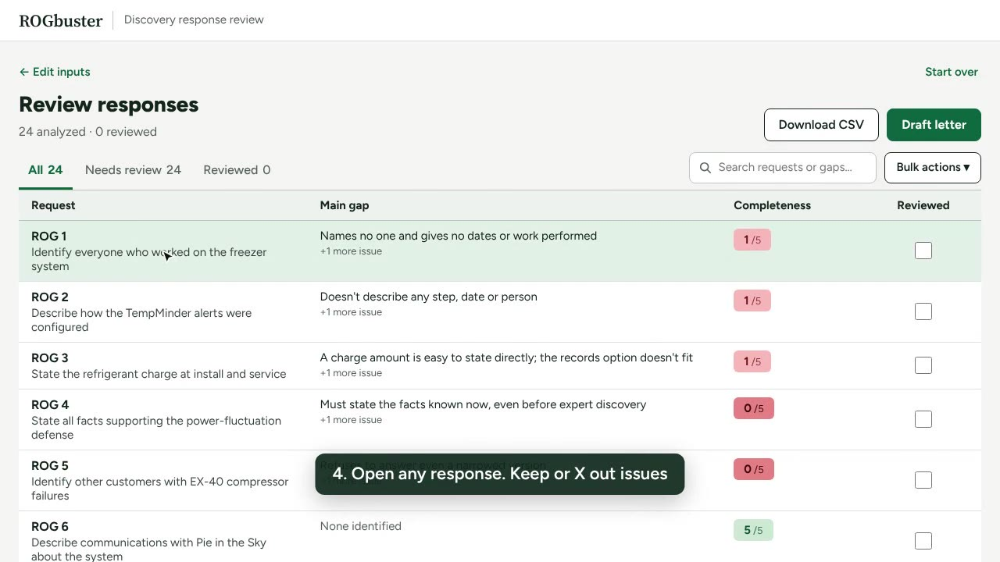

# 👻 ROGbuster

**Don’t let evasive answers haunt your case.**

ROGbuster is a free, open-source app that runs inside Claude. Upload the other side's answers to your interrogatories, requests for production and requests for admission. ROGbuster scores how complete each response is, lists what's missing, and drafts your meet-and-confer letter.

**[Open ROGbuster](https://claude.ai/artifact/HWreJdNHydUA8atQdkzDR8)** · [rogbuster.com](https://rogbuster.com) · [Watch the 43-second demo](docs/rogbuster-demo.mp4)

## How it works

1. **Upload their responses.** PDF, Word, text or photos. Scanned PDFs are read with OCR. If you upload the wrong document (a complaint, or your own requests), ROGbuster tells you and moves it to the right step.
2. **Add your requests and the complaint (optional).** Each answer is then judged against what you actually asked and what the case is about.
3. **Add court rules (optional).** Upload local rules or the judge's standing order. Claude pulls out the discovery requirements; you check the list, and the analysis and letter cite the ones you keep.
4. **Review the gaps.** Every response gets a 0–5 completeness score and a list of issues. Change the score, X out an issue, add your own, and mark each response reviewed.
5. **Draft the letter.** One click drafts a meet-and-confer letter covering every deficient response, addressed to opposing counsel from the signature block in their responses. You can also export everything to CSV.

## What you need

A Claude account and a web browser. There's nothing to install and nothing to pay for. The analysis runs on your own Claude account, so your plan's usage limits apply.

## Where your documents go

- Your files are read in your browser.
- Their text is sent to Claude, through your own Claude account, to do the analysis.
- Your work in progress is saved in your browser's local storage on that device.
- ROGbuster has no server of its own.

Follow your firm's policies on using AI tools with client material.

## Not legal advice

ROGbuster is a first pass that points you at likely problems. Claude can miss things or get them wrong. Read each response yourself and edit the letter before you send it.

## What's in this repo

| Path | What it is |
|---|---|
| `app/rogbuster.html` | The whole app: one HTML file with inline CSS and JavaScript. |
| `docs/` | The rogbuster.com website, served by GitHub Pages. |
| `test-docs/` | A fictional case (*Pie in the Sky Bakery v. Frostbyte Refrigeration*) for trying ROGbuster out: complaint, requests, responses, a scanned copy of the responses, and an answer key listing what a good review should catch. `test-docs/rules/` has fictional local rules and a standing order for the Rules step. |

## Running your own copy

`app/rogbuster.html` is built to run as a Claude artifact, because it calls Claude through the artifact runtime (`window.claude`). It won't analyze anything if you open the file directly in a browser. To run a modified version, publish the file as an artifact from Claude with the `sample` and `downloads` capabilities.

The app loads pdf.js, mammoth (for .docx) and Tesseract (for OCR) from public CDNs at runtime.

## Contributing

Issues and pull requests are welcome. If a response was scored badly, an issue with the (redacted) response text and what you expected helps the most.

## License

[MIT](LICENSE)
